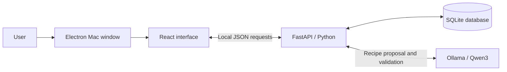

# Savor project summary

## What Savor is

Savor helps people use groceries they already have, find meals that fit those groceries, and request small missing amounts from private communities or friends. The main workflow is:

**Pantry → choose servings, diet and cooking time → AI generates a meal idea → review the result → cook or request missing ingredients → confirmed pickup → cooking record.**

The current deliverable is a **Mac desktop demo with a phone-style interface**, using the team's original slide-deck logo. It runs locally with three sample accounts: Alex, Jamie and Sam. The source is on **feat/savor-demo**, proposed in [draft PR #1](https://github.com/miggymaliksi/CO-TC-Case-Comp-Winners/pull/1). A teammate reviews before merging into main.

## How to run it yourself in VS Code

1. Open **VS Code → File → Open Folder**. Choose the Savor folder at `/Users/miguelmaliksi/Documents/Codex/2026-10-31/i-x20/outputs/Savor`.
2. Use the **Terminal menu → Run Task → Savor: Open phone demo**.
3. Wait for the separate Savor window. Keep the task's terminal open while using the app. Closing Savor stops its backend and a model service it started itself.
4. Repeat the same task to launch again. If Savor is already running, the launcher brings its window forward and explains that it is already open.

You do not need to edit a Python file or activate the environment just to launch. This Mac already has the local model downloaded. No paid AI API key is needed.

If using the terminal directly, the command is `python3 run.py --desktop` from the Savor folder. Paste only command text. **Run Task is a VS Code menu action**, not a shell command. If the terminal says **bquote>**, press **Control + C** to cancel the unfinished backtick input. Leave out Markdown markers such as three backticks and `sh`.

The task and command were checked against the current launcher. A local edit that had removed desktop startup was preserved in a backup and the missing block was restored. The window activation behavior was also updated so a launch brings the app forward.

## Technical rundown

| Technology | Role in our app | How to explain it |
| --- | --- | --- |
| **Electron** | Mac window, Dock icon and local-service lifecycle | It wraps the interface in a desktop application, opens a phone-width window, and starts the Python backend. |
| **React** | Screens, forms, navigation and updates | It controls what users see and sends their actions to the backend. |
| **Vite** | Interface development and build tool | It converts the React code, styles and images into files the app can load. |
| **FastAPI / Python** | API routes and business rules | It validates input, checks account access, calculates recipe coverage, and controls requests, reservations and cooking. |
| **SQLite / SQLAlchemy** | Persistent records and their relationships | SQLite stores the database in a local file. SQLAlchemy lets Python work with database records as models. |
| **Ollama / Qwen3 4B** | Personalized meal generation | Ollama runs Qwen on this computer. Qwen creates a recipe for the pantry and selected servings, diet and time. Python checks the result before saving it. |
| **Git / GitHub** | Version history and team review | Each contributor works in their own checkout and feature branch, pushes changes, and opens a PR for teammate review. |

### Follow one Save button click

React collects the ingredient, amount, unit, location and storage date. It sends those values as **JSON**, a structured text format, to FastAPI. Python checks that the values are valid and the sample account owns the item. SQLAlchemy writes the record to SQLite. The updated state comes back and React refreshes the card.

The records survive closing the app because they are in `savor.db`. Local databases, installed packages, model downloads and credentials are ignored by Git. Each checkout has its own records; teammates on different computers do not currently share a live backend.

### Recipe matching and inventory consistency

Coverage is calculated by ordinary Python code:

**Fully covered ingredient lines ÷ total ingredient lines × 100.**

Four covered lines out of five gives 80%. An ingredient only counts as covered when there is enough compatible quantity for the selected serving count. The app converts compatible mass and volume units; it does not guess how many grams are in one tomato. Recommended ideas start at 80%; pantry-only ideas require 100%.

When Jamie accepts Alex's request, the server reserves real stock from Jamie. Confirmed pickup transfers the reserved amount once into Alex's pantry and keeps its storage date. Cancelling before pickup returns the reservation. Confirmed cooking deducts recipe quantities and saves a meal record.

A **transaction** keeps related updates together: they all succeed or roll back. **Idempotency** means repeating the same action identifier does not repeat its effect. These mechanisms help prevent double sharing and duplicate deductions. Pending requests can expire at their deadlines; accepted reservations stay held until pickup or cancellation.

### Sessions, privacy and chat

The backend checks pantry ownership, community membership and access to private pickup chats. Demo identity switching deliberately lets a presenter select any of the three sample accounts. This is not production sign-in. Local sessions use server-side tokens and HttpOnly, SameSite cookies. The app is restricted to local addresses.

Chat is implemented using polling: open chats refresh every four seconds, and general app state refreshes every eight seconds. External push notifications and a WebSocket connection are future work.

## What the AI actually does

Savor currently has two recipe sources:

- **Four curated sample recipes**, stored in `backend/recipes.py`.
- **AI-generated meal ideas**, created by Qwen using patterns learned during training, the pantry and the selected servings, dietary preference and cooking time.

The current app does not search recipe websites or query a recipe database API. A generated suggestion does not have a traceable cookbook or website source. We integrated a pretrained model; we did not train a model or build a recipe training dataset.

When the user clicks **Set preferences & generate**:

1. Choose servings, dietary preference and maximum cooking time. **Save preferences & generate** saves those settings and starts AI generation.
2. Python reads the pantry and saved preferences, checks for a recent matching idea, then shortlists compatible ingredients and bounded recipe portions. It sends a local request for one structured recipe; chats and identities are excluded.
3. The model proposes a name, servings, quantities and cooking steps.
4. Python validates the structure and performs quantity, ingredient, time, preference and coverage checks.
5. A valid result appears in **Your AI ideas**, with the preferences used, recipe quantities, steps and pantry coverage. Changing the pantry or preferences removes older ideas from this current view; compatible history remains under **Saved AI**. A failed generation keeps the saved preferences and leaves the pantry unchanged.

Matching suggestions can be reused for **15 minutes** when pantry and preferences are unchanged. The downloaded model is about **2.5 GB**. Local generation has no per-request API fee, but uses memory, processing power and time. It can take a minute or two and can fail validation. Validation does not guarantee taste, recipe quality or brand-specific dietary suitability.

**The AI suggests recipes. Python controls recipe coverage, permissions, sharing and inventory changes.**

## What is implemented

| Area | Working in the local prototype |
| --- | --- |
| App presentation | Phone-style Mac window, bottom navigation, responsive screens and the original team logo |
| Pantry | Add, edit and remove groceries; quantities, units, storage dates and locations; persistent records |
| Recipes | Preferences-first AI generation and personalized results, saved AI history, four curated examples and quantity-aware coverage |
| Sharing | Exact-amount requests to private communities or sample friends, deadlines, accept/pass/cancel and reservations |
| Pickup | Private coordination chat and confirmed, repeat-safe inventory transfer |
| Communities and friends | Private groups, invite-code joining, sample friend connections and community chat |
| Cooking and impact | Quantity deduction after cooking, saved meals, confirmed exchanges and a basic leaderboard |
| Receipt demo | Editable sample receipt and atomic import into the pantry |
| Engineering | Server validation/access checks, persistence, additive schema migration, duplicate protection, focused API tests and GitHub review workflow |

The initial accounts, groceries, messages and four curated dishes are sample content. Food artwork is illustrative. Generated recipes are labeled. Impact displays recorded actions; it does not calculate measured food-weight reduction or dollar savings.

## Features still missing

### Needed for a shared, public product

- **Production accounts and sign-in**, such as a properly integrated identity provider.
- **A shared hosted backend and database**, so real users on separate devices see the same requests and chats.
- **An iPhone/Android package**, device testing, signing and release work. The present demo is a Mac application.
- **A portable installer**, because the current Mac launcher relies on its prepared project folder, Python environment, built interface and local model.
- Operational deployment work, database backups and testing of the hosted database configuration. PostgreSQL configuration exists but has not been checked against a running instance.

### Product integrations and improvements

- **Recipe API integration** for a larger external catalog and source attribution where provided.
- **Live receipt extraction** from actual images; the current receipt screen uses an editable sample.
- **Scheduled morning messages and external push notifications**; current updates appear while the local app is open.
- Contacts/proximity discovery, shared-calendar features, games and prizes if retained in the team's roadmap.
- Better model-quality evaluation and generation latency. The small local model can produce invalid suggestions.
- Measured savings estimates, which require actual food-weight/cost data and a defined comparison method.

Expiration predictions, food-safety classifications, payments, buying/selling, deliveries and a public social feed are intentionally outside the current scope. Storage age means days since recorded storage, not an expiry prediction. The team's 9,000-request figure is an aspiration, not achieved usage.

## Recipe API status

**The food API has been removed. AI is the generator for this version.** The main flow uses your pantry and preferences directly, with no recipe-library search or source lookup.

The downloaded Qwen model runs through Ollama on the computer. It produces the meal idea, ingredient amounts and steps. FastAPI validates that proposal and controls inventory; the AI cannot change pantry records directly.

What to tell the team:

- No external food or recipe API is used. Recipe generation sends pantry/preferences only to the local model service.
- An AI suggestion has no cookbook or website citation. It is generated by the pretrained model and checked by the app. Curated sample recipes remain clearly separate in **All ideas**.

No paid AI plan or API account is required. After local model setup, generation can run without an internet recipe service. It can still be slow or fail validation.

## Two-minute mock demo

Before the timer, use **Alex**, **2 servings**, **All** diets and **60 minutes** maximum. Prepare one valid local AI result, then keep the pantry unchanged. Check that **Garden tomato toast** shows **80%**, with **2 slices of bread** missing, and that **Sam** has at least 2 slices. The AI result and the curated sharing example are labeled separately. Practice changes persist.

Aim for **1:45**, keeping **15 seconds for slower clicks**. The timed demo includes sending and accepting a real request in the local sample-account app.

| Time | Show / do | Say aloud |
| --- | --- | --- |
| **0:00–0:10** | Home | “Savor helps you cook with what you have and borrow the small ingredients you're missing.” |
| **0:10–0:35** | Recipes → Your AI ideas. Point to the preference summary and open the prepared result, then close it. | “I choose servings, diet and time. Local AI creates a meal idea from my pantry. This result was generated earlier on this computer.” |
| **0:35–0:55** | All ideas → Garden tomato toast. Point to 80% and the missing bread. | “For sharing, this curated sample is missing two slices of bread. Four of its five ingredient lines are already covered.” |
| **0:55–1:20** | Ask beside Bread → check 2 slice, Community · PBL and In 30 minutes → Send request. | “I request just the missing amount from my private community, with a deadline. It now appears in My requests.” |
| **1:20–1:40** | Top-right account button → Sam → Community → Requests → I can share on Alex's bread request. | “Switching sample accounts shows the other side. Sam accepts, and the app reserves two slices until pickup.” |
| **1:40–1:45** | Keep the accepted request visible. | “A little help from your community makes dinner possible.” |

If behind at 1:20, finish on Alex's sent request and explain that a neighbor can accept it. Keep fresh AI generation, pickup chat and confirmed pickup for Q&A. Do not present the curated sharing example as AI output.

## Questions to be ready for

- **Where are the recipes from?** The main results are generated by Qwen from your pantry and preferences. Four curated samples remain in All ideas. No external recipe API is connected.
- **What did we build ourselves?** The interface, pantry and request flows, quantity matching, inventory rules, database connections and model integration/validation.
- **Did we train AI?** No; we integrated Qwen through Ollama.
- **Is it free to use AI?** This local version has no paid API calls. The costs are local disk space, memory, processing and time.
- **Can two people accept the same request?** The backend serializes/locks the update and rechecks its state, so only one acceptance succeeds.
- **Is it real-time chat?** It refreshes periodically while open; it currently uses polling.
- **Can teammates use their phones together?** A shared backend, real sign-in and mobile packaging are still needed. Current sample-account switching demonstrates both sides locally.
- **Is the camera scanning?** The current receipt workflow is an editable sample.

## Useful code and guides

Start with `frontend/src/App.jsx` for screens, `components.jsx` for forms, `backend/main.py` for API/business rules, `backend/recipes.py` for matching, `backend/local_ai.py` for AI, and `backend/models.py` for records. `run.py`, `.vscode/tasks.json` and `desktop/main.cjs` control launching.

- [Run and present: beginner steps and script](RUN_AND_PRESENT.md)
- [Detailed technical rundown](TECHNICAL_RUNDOWN.md)
- [Demo preparation and complete exchange](DEMO_GUIDE.md)
- [Team handoff and contribution workflow](TEAM_HANDOFF.md)
- [Logo source and assets](BRAND_ASSETS.md)
