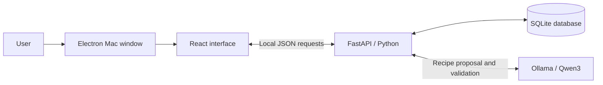

# Savor project summary

## What Savor is

Savor helps people use groceries they already have, find meals that fit those groceries, and request small missing amounts from private communities or friends. The main workflow is:

**Pantry → recipe match → missing ingredient request → neighbor accepts → confirmed pickup → cooking record.**

The current deliverable is a **Mac desktop demo with a phone-style interface**, using the team's original slide-deck logo. It runs locally with three sample accounts: Alex, Jamie and Sam. The source is on **feat/savor-demo**, proposed in [draft PR #1](https://github.com/miggymaliksi/CO-TC-Case-Comp-Winners/pull/1). A teammate reviews before merging into main.

## How to run it yourself in VS Code

1. Open **VS Code → File → Open Folder**. Choose the Savor folder at `/Users/miguelmaliksi/Documents/Codex/2026-10-31/i-x20/outputs/Savor`.
2. Use the **Terminal menu → Run Task → Savor: Open phone demo**.
3. Wait for the separate Savor window. Keep the task's terminal open while using the app. Closing Savor stops its backend and a model service it started itself.
4. Repeat the same task to launch again. If Savor is already running, the launcher brings its window forward and explains that it is already open.

You do not need to edit a Python file or activate the environment just to launch. This Mac already has the local model downloaded. No paid AI API key is needed.

If using the terminal directly, the command is `python3 run.py --desktop` from the Savor folder. Paste only command text. **Run Task is a VS Code menu action**, not a shell command. If the terminal says **bquote>**, press **Control + C** to cancel the unfinished backtick input. Leave out Markdown markers such as three backticks and `sh`.

The task and command were checked against the current launcher. A local edit that had removed desktop startup was preserved in a backup and the missing block was restored. The window activation behavior was also updated so a launch brings the app forward.

## Technical rundown

| Technology | Role in our app | How to explain it |
| --- | --- | --- |
| **Electron** | Mac window, Dock icon and local-service lifecycle | It wraps the interface in a desktop application, opens a phone-width window, and starts the Python backend. |
| **React** | Screens, forms, navigation and updates | It controls what users see and sends their actions to the backend. |
| **Vite** | Interface development and build tool | It converts the React code, styles and images into files the app can load. |
| **FastAPI / Python** | API routes and business rules | It validates input, checks account access, calculates recipe coverage, and controls requests, reservations and cooking. |
| **SQLite / SQLAlchemy** | Persistent records and their relationships | SQLite stores the database in a local file. SQLAlchemy lets Python work with database records as models. |
| **Ollama / Qwen3 4B** | Optional local recipe generation | Ollama runs the downloaded Qwen model on the computer. Qwen proposes recipes, and Python validates the output. |
| **Git / GitHub** | Version history and team review | Each contributor works in their own checkout and feature branch, pushes changes, and opens a PR for teammate review. |

### Follow one Save button click

React collects the ingredient, amount, unit, location and storage date. It sends those values as **JSON**, a structured text format, to FastAPI. Python checks that the values are valid and the sample account owns the item. SQLAlchemy writes the record to SQLite. The updated state comes back and React refreshes the card.

The records survive closing the app because they are in `savor.db`. Local databases, installed packages, model downloads and credentials are ignored by Git. Each checkout has its own records; teammates on different computers do not currently share a live backend.

### Recipe matching and inventory consistency

Coverage is calculated by ordinary Python code:

**Fully covered ingredient lines ÷ total ingredient lines × 100.**

Four covered lines out of five gives 80%. An ingredient only counts as covered when there is enough compatible quantity for the selected serving count. The app converts compatible mass and volume units; it does not guess how many grams are in one tomato. Recommended ideas start at 80%; pantry-only ideas require 100%.

When Jamie accepts Alex's request, the server reserves real stock from Jamie. Confirmed pickup transfers the reserved amount once into Alex's pantry and keeps its storage date. Cancelling before pickup returns the reservation. Confirmed cooking deducts recipe quantities and saves a meal record.

A **transaction** keeps related updates together: they all succeed or roll back. **Idempotency** means repeating the same action identifier does not repeat its effect. These mechanisms help prevent double sharing and duplicate deductions. Pending requests can expire at their deadlines; accepted reservations stay held until pickup or cancellation.

### Sessions, privacy and chat

The backend checks pantry ownership, community membership and access to private pickup chats. Demo identity switching deliberately lets a presenter select any of the three sample accounts. This is not production sign-in. Local sessions use server-side tokens and HttpOnly, SameSite cookies. The app is restricted to local addresses.

Chat is implemented using polling: open chats refresh every four seconds, and general app state refreshes every eight seconds. External push notifications and a WebSocket connection are future work.

## What the AI actually does

Savor currently has two recipe sources:

- **Four curated sample recipes**, stored in `backend/recipes.py`.
- **Model-generated suggestions**, proposed by Qwen using patterns learned during training and the pantry/preferences supplied by our backend.

The current app does not search recipe websites or query a recipe database API. A generated suggestion does not have a traceable cookbook or website source. We integrated a pretrained model; we did not train a model or build a recipe training dataset.

When the user clicks **Generate a dinner idea**:

1. Python reads that account's pantry and preferences and checks for a matching saved result.
2. It shortlists pantry ingredients and sends the model a local request for one structured recipe. Chats and user identities are not included in the recipe prompt.
3. The model proposes a name, servings, quantities and cooking steps.
4. Python validates the structure and performs quantity, ingredient, time, preference and coverage checks.
5. A valid result is saved privately and displayed under **Local AI**. A failed generation does not change inventory.

Matching suggestions can be reused for **15 minutes** when pantry and preferences are unchanged. The downloaded model is about **2.5 GB**. Local generation has no per-request API fee, but uses memory, processing power and time. It can take a minute or two and can fail validation. Validation does not guarantee taste, recipe quality or brand-specific dietary suitability.

**The AI suggests recipes. Python controls recipe coverage, permissions, sharing and inventory changes.**

## What is implemented

| Area | Working in the local prototype |
| --- | --- |
| App presentation | Phone-style Mac window, bottom navigation, responsive screens and the original team logo |
| Pantry | Add, edit and remove groceries; quantities, units, storage dates and locations; persistent records |
| Recipes | Four curated examples, optional local AI suggestions, servings/preferences/time filters and quantity-aware coverage |
| Sharing | Exact-amount requests to private communities or sample friends, deadlines, accept/pass/cancel and reservations |
| Pickup | Private coordination chat and confirmed, repeat-safe inventory transfer |
| Communities and friends | Private groups, invite-code joining, sample friend connections and community chat |
| Cooking and impact | Quantity deduction after cooking, saved meals, confirmed exchanges and a basic leaderboard |
| Receipt demo | Editable sample receipt and atomic import into the pantry |
| Engineering | Server validation/access checks, persistence, additive schema migration, duplicate protection, focused API tests and GitHub review workflow |

The initial accounts, groceries, messages and four curated dishes are sample content. Food artwork is illustrative. Generated recipes are labeled. Impact displays recorded actions; it does not calculate measured food-weight reduction or dollar savings.

## Features still missing

### Needed for a shared, public product

- **Production accounts and sign-in**, such as a properly integrated identity provider.
- **A shared hosted backend and database**, so real users on separate devices see the same requests and chats.
- **An iPhone/Android package**, device testing, signing and release work. The present demo is a Mac application.
- **A portable installer**, because the current Mac launcher relies on its prepared project folder, Python environment, built interface and local model.
- Operational deployment work, database backups and testing of the hosted database configuration. PostgreSQL configuration exists but has not been checked against a running instance.

### Product integrations and improvements

- **Recipe API integration** for a larger external catalog and source attribution where provided.
- **Live receipt extraction** from actual images; the current receipt screen uses an editable sample.
- **Scheduled morning messages and external push notifications**; current updates appear while the local app is open.
- Contacts/proximity discovery, shared-calendar features, games and prizes if retained in the team's roadmap.
- Better model-quality evaluation and generation latency. The small local model can produce invalid suggestions.
- Measured savings estimates, which require actual food-weight/cost data and a defined comparison method.

Expiration predictions, food-safety classifications, payments, buying/selling, deliveries and a public social feed are intentionally outside the current scope. Storage age means days since recorded storage, not an expiry prediction. The team's 9,000-request figure is an aspiration, not achieved usage.

## Should we add a recipe API?

**Recommendation: add a recipe API in the next version, after the current demo.** Use it for catalog recipes with provider/source information, and keep local AI as an optional source of custom suggestions.

The basic HTTP lookup would fit in the Python backend. The more substantial work is mapping ingredient names, parsing quantities and units, scaling servings, storing source information, handling API limits and failures, and reusing our own coverage checks. Preserve cached examples for reliable demonstrations. An API response alone does not guarantee that its ingredient quantities are comparable with our pantry units.

Two options checked in official documentation:

- [TheMealDB](https://www.themealdb.com/api.php) allows its test key for development or educational use. Public app-store release requires supporter access; multi-ingredient filtering is premium. It could support a small educational integration, while Savor still performs its own pantry matching.
- [Spoonacular](https://spoonacular.com/food-api/docs) documents ingredient-based recipe search and structured ingredient amounts/units. Its current account requirements, quotas, terms and cost would need review before choosing it.

No recipe API has been connected, no account has been created for one, and no paid plan has been enabled.

## Two-minute mock demo

Prepare Home as **Alex**, with **2 servings**. Check that Sunday tomato pasta shows **80% with garlic missing** and that a saved generated recipe is available under Local AI. Practice changes persist, so recheck before each rehearsal.

Aim for **1:40**, keeping **20 seconds for slower clicks**.

| Time | Show / do | Say aloud |
| --- | --- | --- |
| **0:00–0:10** | Home | “Savor helps you cook with what you have and borrow the small ingredients you're missing.” |
| **0:10–0:25** | Pantry; point to an amount and storage age | “Here's Alex's pantry. We track amounts and storage dates, and these records stay saved after closing the app.” |
| **0:25–0:55** | Recipes → All ideas → Sunday tomato pasta → garlic's Ask. Check 1 clove, Community · PBL, In 30 minutes → Send request. | “This pasta matches four of five ingredients. Garlic is missing, so it shows 80%. I can ask my community for just one clove.” |
| **0:55–1:10** | Community → Requests; show the new request | “The request is now in Alex's community. A neighbor can accept it, and confirmed pickup updates both pantries.” |
| **1:10–1:30** | Recipes → Local AI; open a saved generated recipe | “This recipe was generated earlier on this computer from the pantry. We use a local AI model without paid API calls, and our code checks the result before showing it.” |
| **1:30–1:40** | Keep the recipe visible | “That's Savor: turn what you already have into a meal, with a little help from your community.” |

If behind at 1:30, give the closing sentence from the current screen. Keep fresh AI generation, account switching, pickup/cooking and deeper technical explanations for Q&A.

## Questions to be ready for

- **Where are the recipes from?** Four curated samples plus suggestions generated by a pretrained local model. External recipe search is a future integration.
- **What did we build ourselves?** The interface, pantry and request flows, quantity matching, inventory rules, database connections and model integration/validation.
- **Did we train AI?** No; we integrated Qwen through Ollama.
- **Is it free to use AI?** This local version has no paid API calls. The costs are local disk space, memory, processing and time.
- **Can two people accept the same request?** The backend serializes/locks the update and rechecks its state, so only one acceptance succeeds.
- **Is it real-time chat?** It refreshes periodically while open; it currently uses polling.
- **Can teammates use their phones together?** A shared backend, real sign-in and mobile packaging are still needed. Current sample-account switching demonstrates both sides locally.
- **Is the camera scanning?** The current receipt workflow is an editable sample.

## Useful code and guides

Start with `frontend/src/App.jsx` for screens, `components.jsx` for forms, `backend/main.py` for API/business rules, `backend/recipes.py` for matching, `backend/local_ai.py` for AI, and `backend/models.py` for records. `run.py`, `.vscode/tasks.json` and `desktop/main.cjs` control launching.

- [Run and present: beginner steps and script](RUN_AND_PRESENT.md)
- [Detailed technical rundown](TECHNICAL_RUNDOWN.md)
- [Demo preparation and complete exchange](DEMO_GUIDE.md)
- [Team handoff and contribution workflow](TEAM_HANDOFF.md)
- [Logo source and assets](BRAND_ASSETS.md)
