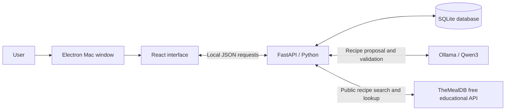

# Savor project summary

## What Savor is

Savor helps people use groceries they already have, find meals that fit those groceries, and request small missing amounts from private communities or friends. The main workflow is:

**Pantry → choose servings, diet and cooking time → AI meal idea → cook or request missing ingredients → confirmed pickup → cooking record.** You can also browse TheMealDB and ask local AI to adapt a recipe to your settings and pantry.

The current deliverable is a **Mac desktop demo with a phone-style interface**, using the team's original slide-deck logo. It runs locally with three sample accounts: Alex, Jamie and Sam. The source is on **feat/savor-demo**, proposed in [draft PR #1](https://github.com/miggymaliksi/CO-TC-Case-Comp-Winners/pull/1). A teammate reviews before merging into main.

## How to run it yourself in VS Code

1. Open **VS Code → File → Open Folder**. Choose the Savor folder at `/Users/miguelmaliksi/Documents/Codex/2026-10-31/i-x20/outputs/Savor`.
2. Use the **Terminal menu → Run Task → Savor: Open phone demo**.
3. Wait for the separate Savor window. Keep the task's terminal open while using the app. Closing Savor stops its backend and a model service it started itself.
4. Repeat the same task to launch again. If Savor is already running, the launcher brings its window forward and explains that it is already open.

You do not need to edit a Python file or activate the environment just to launch. This Mac already has the local model downloaded. No paid AI API key is needed.

If using the terminal directly, the command is `python3 run.py --desktop` from the Savor folder. Paste only command text. **Run Task is a VS Code menu action**, not a shell command. If the terminal says **bquote>**, press **Control + C** to cancel the unfinished backtick input. Leave out Markdown markers such as three backticks and `sh`.

The task and command were checked against the current launcher. A local edit that had removed desktop startup was preserved in a backup and the missing block was restored. The window activation behavior was also updated so a launch brings the app forward.

## Technical rundown

| Technology | Role in our app | How to explain it |
| --- | --- | --- |
| **Electron** | Mac window, Dock icon and local-service lifecycle | It wraps the interface in a desktop application, opens a phone-width window, and starts the Python backend. |
| **React** | Screens, forms, navigation and updates | It controls what users see and sends their actions to the backend. |
| **Vite** | Interface development and build tool | It converts the React code, styles and images into files the app can load. |
| **FastAPI / Python** | API routes and business rules | It validates input, checks account access, fetches TheMealDB recipes, calculates coverage, and controls requests, reservations and cooking. |
| **SQLite / SQLAlchemy** | Persistent records and their relationships | SQLite stores the database in a local file. SQLAlchemy lets Python work with database records as models. |
| **Ollama / Qwen3 4B** | Personalized local recipe generation | Ollama runs the downloaded Qwen model. Qwen proposes meals for the selected preferences and pantry, optionally inspired by a library recipe; Python validates the output. |
| **Git / GitHub** | Version history and team review | Each contributor works in their own checkout and feature branch, pushes changes, and opens a PR for teammate review. |

### Follow one Save button click

React collects the ingredient, amount, unit, location and storage date. It sends those values as **JSON**, a structured text format, to FastAPI. Python checks that the values are valid and the sample account owns the item. SQLAlchemy writes the record to SQLite. The updated state comes back and React refreshes the card.

The records survive closing the app because they are in `savor.db`. Local databases, installed packages, model downloads and credentials are ignored by Git. Each checkout has its own records; teammates on different computers do not currently share a live backend.

### Recipe matching and inventory consistency

Coverage is calculated by ordinary Python code:

**Fully covered ingredient lines ÷ total ingredient lines × 100.**

Four covered lines out of five gives 80%. An ingredient only counts as covered when there is enough compatible quantity for the selected serving count. The app converts compatible mass and volume units; it does not guess how many grams are in one tomato. Recommended ideas start at 80%; pantry-only ideas require 100%.

When Jamie accepts Alex's request, the server reserves real stock from Jamie. Confirmed pickup transfers the reserved amount once into Alex's pantry and keeps its storage date. Cancelling before pickup returns the reservation. Confirmed cooking deducts recipe quantities and saves a meal record.

A **transaction** keeps related updates together: they all succeed or roll back. **Idempotency** means repeating the same action identifier does not repeat its effect. These mechanisms help prevent double sharing and duplicate deductions. Pending requests can expire at their deadlines; accepted reservations stay held until pickup or cancellation.

### Sessions, privacy and chat

The backend checks pantry ownership, community membership and access to private pickup chats. Demo identity switching deliberately lets a presenter select any of the three sample accounts. This is not production sign-in. Local sessions use server-side tokens and HttpOnly, SameSite cookies. The app is restricted to local addresses.

Chat is implemented using polling: open chats refresh every four seconds, and general app state refreshes every eight seconds. External push notifications and a WebSocket connection are future work.

## What the AI actually does

Savor now combines three recipe sources:

- **Four curated sample recipes**, stored in `backend/recipes.py`.
- **TheMealDB recipes**, fetched from its free educational API with original ingredient measures, photos, instructions and a source link.
- **Model-generated suggestions**, proposed by Qwen from the pantry and selected preferences, optionally using a library recipe as inspiration.

The library searches a recipe database API, rather than scraping websites. An AI adaptation links its inspiration source, but it is a new suggestion, not the publisher's original recipe. A pantry-only generated suggestion has no traceable cookbook source. We integrated a pretrained model; we did not train one.

When the user clicks **Set preferences & generate**:

1. Choose servings, dietary preference and maximum cooking time, then click **Save preferences & generate**. The app saves those settings before requesting a meal idea.
2. Python checks for a recent matching result, shortlists compatible pantry ingredients and sends a local request for one structured recipe. An adaptation also includes public recipe inspiration. Chats and user identities are excluded.
3. The model proposes a name, servings, quantities and cooking steps.
4. Python validates the structure and performs quantity, ingredient, time, preference and coverage checks.
5. A valid result is saved privately under **Your AI ideas**, labeled with the preferences used. Changing preferences or pantry moves older results out of that current view; compatible older results remain in **Saved AI**. A failed generation keeps the saved preferences and leaves inventory unchanged.

Matching suggestions can be reused for **15 minutes** when pantry, preferences and selected inspiration are unchanged. The model download is about **2.5 GB**. Generation has no API fee, but uses memory and processing time; it can take a minute or two or fail validation. Checks do not guarantee taste, recipe quality or brand-specific dietary suitability.

**The AI suggests recipes. Python controls recipe coverage, permissions, sharing and inventory changes.**

## What is implemented

| Area | Working in the local prototype |
| --- | --- |
| App presentation | Phone-style Mac window, bottom navigation, responsive screens and the original team logo |
| Pantry | Add, edit and remove groceries; quantities, units, storage dates and locations; persistent records |
| Recipes | Preferences-first local AI, TheMealDB search/detail/source links, AI adaptations, four curated examples and quantity-aware coverage |
| Sharing | Exact-amount requests to private communities or sample friends, deadlines, accept/pass/cancel and reservations |
| Pickup | Private coordination chat and confirmed, repeat-safe inventory transfer |
| Communities and friends | Private groups, invite-code joining, sample friend connections and community chat |
| Cooking and impact | Quantity deduction after cooking, saved meals, confirmed exchanges and a basic leaderboard |
| Receipt demo | Editable sample receipt and atomic import into the pantry |
| Engineering | Server validation/access checks, persistence, additive schema migration, duplicate protection, focused API tests and GitHub review workflow |

The initial accounts, groceries, messages and four curated dishes are sample content. Curated/generated food artwork is illustrative; library photos come from TheMealDB. Generated recipes and adaptations are labeled. Impact counts recorded actions, not measured food-weight reduction or dollar savings.

## Features still missing

### Needed for a shared, public product

- **Production accounts and sign-in**, such as a properly integrated identity provider.
- **A shared hosted backend and database**, so real users on separate devices see the same requests and chats.
- **An iPhone/Android package**, device testing, signing and release work. The present demo is a Mac application.
- **A portable installer**, because the current Mac launcher relies on its prepared project folder, Python environment, built interface and local model.
- Operational deployment work, database backups and testing of the hosted database configuration. PostgreSQL configuration exists but has not been checked against a running instance.

### Product integrations and improvements

- **Automatic quantity/unit and serving normalization for library recipes**. Original API records are browseable; an AI adaptation must pass Savor's checks before it enters the cooking/inventory workflow.
- **Live receipt extraction** from actual images; the current receipt screen uses an editable sample.
- **Scheduled morning messages and external push notifications**; current updates appear while the local app is open.
- Contacts/proximity discovery, shared-calendar features, games and prizes if retained in the team's roadmap.
- Better model-quality evaluation and generation latency. The small local model can produce invalid suggestions.
- Measured savings estimates, which require actual food-weight/cost data and a defined comparison method.

Expiration predictions, food-safety classifications, payments, buying/selling, deliveries and a public social feed are intentionally outside the current scope. Storage age means days since recorded storage, not an expiry prediction. The team's 9,000-request figure is an aspiration, not achieved usage.

## Free recipe API and its limits

**TheMealDB is now connected for this educational demo.** Open **Recipes → Recipe library**, search by one ingredient or a meal name, and open a recipe. **Set preferences & adapt** asks local AI to make a new version using your pantry and chosen settings.

The Python backend calls fixed TheMealDB endpoints, limits results to 12 and caches responses for 15 minutes. Searches require internet. Only the search term or recipe ID goes to the provider; pantry quantities, dietary settings, identities and chats are not sent. Recipe photos load from TheMealDB. Local AI inference stays on the computer.

Important limits:

- [TheMealDB](https://www.themealdb.com/api.php) allows public test key **1** for development/education, with no paid account. Public app-store release requires supporter access, and multi-ingredient filtering is premium. This version uses free single-ingredient/name search and ID lookup only.
- The provider does not supply reliable serving counts or cooking time in these results. Original measures such as “1 tin” remain unchanged. We do not assign fake pantry coverage, scale them or deduct them directly. AI adaptations have separate quantities and checks.

No paid plan, private API key or cloud AI account is needed. The library can be unavailable; saved ideas, curated examples and local pantry features remain available.

## Two-minute mock demo

Before the timer, generate an idea for Alex with **2 servings**, your chosen diet and time. Keep pantry/preferences unchanged so it stays in **Your AI ideas**. Check the library while online. Fresh generation can take most of the demo slot; show a saved result honestly. Practice changes persist.

Aim for **1:40**, keeping **20 seconds for slower clicks**.

| Time | Show / do | Say aloud |
| --- | --- | --- |
| **0:00–0:10** | Home | “Savor helps you cook with what you have and borrow the small ingredients you're missing.” |
| **0:10–0:25** | Pantry; point to an amount and storage age | “Here's Alex's pantry. We track amounts and storage dates, and these records stay saved after closing the app.” |
| **0:25–0:45** | Recipes → Set preferences & generate; show the controls, then close the dialog | “I choose servings, diet and time. Saving these preferences asks AI to create a meal using this pantry.” |
| **0:45–1:10** | Your AI ideas → open the prepared result, show its preference label and coverage | “I generated this earlier on this computer. Python checked the quantities and preferences. The model suggests a meal; it cannot change our groceries.” |
| **1:10–1:30** | Close result → Recipe library → open a recipe | “We also search TheMealDB for real recipes with sources. Set preferences and adapt makes a new pantry-based version. Missing ingredients can be requested through our community flow.” |
| **1:30–1:40** | Keep the recipe visible | “That's Savor: turn what you already have into a meal, with a little help from your community.” |

If behind at 1:30, close from the current screen. Keep fresh generation, account switching and the complete request/pickup/cooking flow for Q&A. If the library is offline, use the saved AI result and explain the external search needs internet.

## Questions to be ready for

- **Where are the recipes from?** Four curated samples, original recipes from TheMealDB, and suggestions generated by Qwen. Adaptations link their inspiration and are labeled separately from the original.
- **What did we build ourselves?** The interface, pantry and request flows, quantity matching, inventory rules, database connections and model integration/validation.
- **Did we train AI?** No; we integrated Qwen through Ollama.
- **Is it free to use AI?** This local version has no paid API calls. The costs are local disk space, memory, processing and time.
- **Can two people accept the same request?** The backend serializes/locks the update and rechecks its state, so only one acceptance succeeds.
- **Is it real-time chat?** It refreshes periodically while open; it currently uses polling.
- **Can teammates use their phones together?** A shared backend, real sign-in and mobile packaging are still needed. Current sample-account switching demonstrates both sides locally.
- **Is the camera scanning?** The current receipt workflow is an editable sample.

## Useful code and guides

Start with `frontend/src/App.jsx` for screens, `components.jsx` for forms, `RecipeLibrary.jsx` for browsing, `backend/main.py` for routes/business rules, `backend/recipe_library.py` for TheMealDB, `backend/recipes.py` for matching, `backend/local_ai.py` for AI, and `backend/models.py` for records. `run.py`, `.vscode/tasks.json` and `desktop/main.cjs` control launching.

- [Run and present: beginner steps and script](RUN_AND_PRESENT.md)
- [Detailed technical rundown](TECHNICAL_RUNDOWN.md)
- [Demo preparation and complete exchange](DEMO_GUIDE.md)
- [Team handoff and contribution workflow](TEAM_HANDOFF.md)
- [Logo source and assets](BRAND_ASSETS.md)
