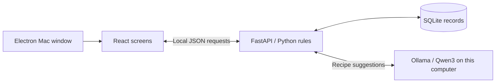

# Savor: team handoff

## Where the code is

Repository: https://github.com/miggymaliksi/CO-TC-Case-Comp-Winners

The working app is on **feat/savor-demo**, proposed in [draft PR #1](https://github.com/miggymaliksi/CO-TC-Case-Comp-Winners/pull/1). A pull request lets teammates review changes before combining them into **main**. Another teammate must review before merging. Pushing source code does not put the app online; this demo runs on a local computer.

## How to explain the app

Savor keeps track of groceries, finds recipes that match their quantities, and lets people request small missing ingredients from private communities or friends. The screen sends actions to a Python backend. Python checks the rules and saves records in a local database. A downloaded AI model can suggest recipes, but the app's own code checks the result and controls inventory changes.

## Follow the product workflow

1. **Pantry:** Alex adds an ingredient, amount, unit, storage date and location. Python checks the input and saves it under Alex's account.
2. **Recipe matching:** the backend compares recipe requirements with actual pantry quantities for the selected serving count. Four fully covered ingredient lines out of five means **80%**. Matching uses ordinary code, including unit conversions.
3. **Request:** Alex asks a private community or friend for the missing amount, such as **1 clove of garlic**. The request has a deadline.
4. **Acceptance:** Jamie accepts. The server reserves one clove from Jamie's available stock, so it cannot be promised twice. A private pickup chat becomes available to the two participants.
5. **Pickup:** Alex confirms receiving it. The reservation transfers once into Alex's pantry and keeps its original storage date. Cancelling before pickup returns reserved stock to Jamie.
6. **Cooking:** once all quantities are covered, Alex confirms cooking. The server deducts the recipe quantities and records the meal. Duplicate confirmations cannot repeat the inventory effect.

The two-minute presentation shows the pantry, an 80% recipe, a missing-ingredient request, and a saved local AI recipe. Use [DEMO_GUIDE.md](DEMO_GUIDE.md) for the timed script. Save the complete two-account exchange for questions afterward.

## How the technical pieces connect



| Piece | Responsibility | Main files |
| --- | --- | --- |
| Electron | Opens the phone-style Mac window, starts its backend and closes services it owns | `desktop/main.cjs`, `desktop/server.py` |
| React / Vite | Displays screens and forms, sends actions, and updates the interface | `frontend/src/App.jsx`, `components.jsx`, `api.js`, `styles.css` |
| FastAPI / Python | Validates inputs, checks access, applies sharing and cooking rules | `backend/main.py` |
| Recipe matching | Calculates coverage and handles compatible unit conversions | `backend/recipes.py` |
| SQLAlchemy / SQLite | Defines and saves users, groceries, requests, messages and other records | `backend/models.py`, `backend/migrations.py`, local `savor.db` |
| Ollama / Qwen3 4B | Runs a pretrained model locally; proposes structured recipes | `backend/local_ai.py`, `local_ai_runtime.py` |

For **Generate a dinner idea**, Python reads the current account's pantry and preferences, checks for a matching saved suggestion, then calls the local model if needed. It validates structure, servings, ingredients and coverage before saving a private result. Failed generation does not change inventory. No paid AI API is used. We integrated a pretrained model; we did not train one. Format and quantity checks do not guarantee recipe quality.

## How a teammate runs it

Each contributor should use their own checkout. While the demo PR is unmerged, get the app branch explicitly:

```sh
git clone --branch feat/savor-demo https://github.com/miggymaliksi/CO-TC-Case-Comp-Winners.git Savor
cd Savor
```

On a Mac, install Python 3.9+ (3.11+ recommended) and Node.js 22.12+ or 24+, then open the **Savor folder** in VS Code. Choose **Terminal → Run Task → Savor: Open phone demo**, or run:

```sh
python3 run.py --desktop
```

First setup installs packages and builds the interface. The built app on Miguel's Mac relies on his prepared project folder; teammates prepare their own copies. For optional local AI on another computer, install [Ollama](https://ollama.com/download) and run **Savor: Set up free local AI** in VS Code. This downloads about 2.5 GB. No API key is required. See [README](../README.md) for full setup and Mac packaging.

The Git repository includes source, dependency lockfiles and documentation. It excludes installed packages, generated Mac apps, model weights, credentials and database files. **Each checkout has its own demo data.** Two teammates running separate copies do not share a live pantry or chat server. Alex/Jamie/Sam switching demonstrates both sides using the same computer's database.

## How the team changes the code

1. Read [COxTC agent.md](../COxTC%20agent.md), check assignments and open PRs, and agree on the feature being changed.
2. Keep existing local changes safe. Each person works in a separate checkout and their own feature branch. Once PR #1 is reviewed and merged, start new work from updated **main**. Until then, coordinate any work based on the unmerged demo branch.
3. Edit the relevant files. Coordinate changes to shared components, dependencies, routing and database models before overlapping work.
4. Check the affected behavior. For backend changes, run `.venv/bin/python -m pytest backend/test_api.py -q`. For interface changes, run `npm run build --prefix frontend` and inspect the affected screen. Desktop JavaScript checks are `npm run check --prefix desktop`.
5. Commit only the intended files, push your feature branch, and open a PR explaining the change and checks. A teammate reviews before merging. Keep credentials, local records, installed packages and model files out of commits.

## Be accurate about the prototype

This is a **Mac app with a phone-style interface**, using local sample accounts and SQLite. Production sign-in, a shared hosted backend, a real iPhone/Android package, live receipt-image extraction and external notifications are future work. Storage age is not an expiration or food-safety prediction. The interface's impact counts are recorded actions, not measured money or food-waste savings.

For detailed questions about transactions, duplicate protection, access checks and AI validation, use [TECHNICAL_RUNDOWN.md](TECHNICAL_RUNDOWN.md).
