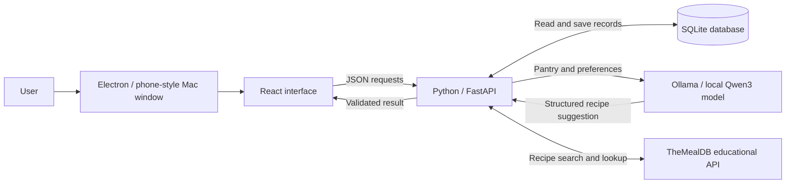

# Explaining Savor's technical design

## The 30-second version

Savor runs in a phone-style Mac window built with Electron. Inside it, React displays the interface, a Python backend applies the app's rules, and SQLite saves the records. The backend matches recipes to actual grocery quantities and controls ingredient requests and inventory updates. Users choose servings, diet and cooking time before generating meal ideas. TheMealDB adds an external recipe library with source links. For personalized suggestions and adaptations, we use a small Qwen model through Ollama on the computer. The model proposes a recipe, but our code checks it before showing it and never lets the model change inventory directly.

## The system diagram

The AI connection goes only to `127.0.0.1:11434` on this computer. The Mac app starts Python on a free loopback port, waits for its health check, then loads that address inside its own window. The browser development launcher uses `127.0.0.1:8000` by default. These addresses stay on this computer.

## The parts you should be able to explain

| Part | What it does | Why we chose it |
| --- | --- | --- |
| Electron | Opens the phone-style Mac window, starts the local Python service and closes owned services on exit | Lets us demo the existing React interface as a desktop app with a Dock icon and bottom navigation |
| React | Displays pantry items, recipe cards, forms, requests and chats | Makes it easier to reuse interface pieces and update the screen when data changes |
| Vite | Prepares the React interface for development and builds its browser files | Gives the team a simple development and build workflow |
| FastAPI / Python | Receives requests, validates inputs, checks access and applies business rules | Keeps important decisions in one server instead of trusting the browser |
| SQLite / SQLAlchemy | Stores connected records such as users, groceries, groups, requests and messages | SQLite makes the local demo easy to run. SQLAlchemy maps Python objects to database rows |
| Ollama / Qwen3 4B | Generates a new recipe from pantry data on the computer | Avoids API fees and cloud inference. A modest local model and a single active generation keep resource use bounded on an 8 GB Mac |
| Git / GitHub | Records versions and lets teammates review a feature branch | Keeps changes reviewable. The draft pull request is a review proposal, not a deployment |

We integrated a pretrained model. We did not train our own model. The model download is about 2.5 GB. Local inference still uses memory, processing power, electricity and time. Ollama cloud features are disabled for the process started by Savor.

The desktop build is a launcher for the prepared checkout on this Mac. It does not bundle Python, the database or several gigabytes of model weights. The checkout stays in place; moving it requires rebuilding the launcher. An iPhone/Android build and a portable, signed installer are later packaging work. The underlying interface is responsive, but this demo does not claim installation on a real phone.

## Follow one request through the app

For adding groceries:

1. The user fills in the React form and clicks **Add to pantry**.
2. The browser sends a JSON request to `POST /api/pantry`.
3. FastAPI identifies the current sample account and validates the quantity, unit, storage date and location.
4. The backend writes a pantry record belonging to that user.
5. The browser loads the updated state and displays the new item.

If the user refreshes the browser, the record is still there because it is in the database. A temporary JavaScript variable would disappear on refresh.

## How recipe matching works

Coverage is calculated by code, not by asking the model to guess a percentage:

**Coverage = ingredient lines with enough compatible pantry quantity ÷ all ingredient lines × 100.**

If a recipe needs five ingredients and the pantry fully covers four, the recipe has 80% coverage. If a recipe needs 300 g of tomatoes but the pantry has only 100 g, that line is not fully covered. Having an item name in the pantry is not enough.

The backend converts compatible units: kilograms to grams, for example. It does not assume that one tomato has a particular weight or that one clove equals one whole garlic bulb. Quantities scale with the selected serving count. Recommended ideas start at 80%; pantry-only options require 100%.

Recipes are sorted by coverage, then the age of relevant groceries, then cooking time. Storage age means “days since recorded storage.” It does not predict expiration or say whether food is safe to eat.

## What happens after Save preferences & generate

1. The interface first saves the selected servings, diet and time, then requests generation. The server reads that user's pantry and saved preferences. Names, units and bounded usable recipe quantities are included; storage age helps order the shortlist. Group chats, other users' data and credentials are not.
2. It checks for a recent saved suggestion for the same pantry, preferences and optional library inspiration. The cache lasts 15 minutes, avoiding unnecessary repeat work.
3. A short per-account cooldown and an in-progress marker prevent repeated clicks from starting competing generations. The database transaction is released during the slower model call.
4. Python shortlists up to four compatible pantry candidates, distinguishes available stock from recipe portions, then sends a local request to Ollama. An optional public recipe is reference data, not instructions. The model is asked for one recipe in a defined JSON structure, with thinking output disabled to keep the small-model response bounded.
5. Pydantic checks the structure. Additional code rejects duplicate or unlisted ingredient names, mismatched servings, cooking-time violations, missing dietary tags, recipes below 80% quantity-aware coverage, excessive oil portions, and dry-starch recipes without a cooking step. These are limited sanity checks, not a complete cooking-safety system.
6. Only a valid result is saved as a private generated recipe. The interface labels it with its generation preferences and shows an illustration. **Your AI ideas** contains exact current-pantry/preference results; compatible older ones remain in **Saved AI**. Adaptations also retain a source link.

The generated recipe can use the same request and cooking flows as the curated recipes. Inventory changes only after explicit exchange/cooking actions. If the model is unavailable or its output fails checks, the app explains the problem and the curated recipes remain usable.

Structured output is a format constraint, not a guarantee of a good recipe. The code checks quantities and format; it cannot prove that a dish will taste good, that a dietary label covers every brand-specific ingredient, or that a suggested meal is safe for a person's allergies. Small local models can make mistakes and may be slow.

## How the free recipe API fits

`GET /api/recipes/library/search` accepts one ingredient or a meal name. The backend calls fixed HTTPS TheMealDB V1 endpoints using public educational key 1. `GET /api/recipes/library/{id}` retrieves original ingredients, measures and method. Search returns at most 12 recipes; a bounded in-memory cache lasts 15 minutes. Requests have a 12-second timeout and do not follow redirects. Images and external links are limited to the provider's expected hosts/routes; the Electron renderer remains isolated.

Only search terms or recipe IDs leave the app through the backend. Recipe images load directly from TheMealDB. Pantry amounts, preferences, identities and chats are not sent. The public provider requires internet; local AI inference stays on the computer.

The provider lacks verified servings and cooking time in these records. We show raw measures and avoid assigning invented pantry coverage or direct inventory deductions. **Set preferences & adapt** passes the recipe ID to generation; Python retrieves the source, and Qwen creates a new, separately validated recipe. This is inspiration, not a faithful scaled copy. Full ingredient/measure normalization remains future work.

The [public test key is for development/education](https://www.themealdb.com/api.php). Public app-store release requires supporter access. We use no premium multi-ingredient search or paid plan.

## How sharing stays consistent

The main states are:

`Pending → Accepted → Completed`

Pending requests can expire or be cancelled. A direct friend request can be declined. If one community member passes, other members can still help.

When Jamie accepts Alex's one-clove request, the backend reserves a real clove from Jamie's available inventory. It cannot be promised to another request or used in another recipe at the same time. Alex confirms pickup before the clove is added to Alex's pantry. Cancelling before pickup returns the reservation to Jamie. Original storage dates travel with the ingredients.

Accepted reservations stay held until pickup or cancellation; the original deadline only expires pending requests. This avoids silently returning an ingredient while two people are arranging an accepted pickup.

A **transaction** means related database changes succeed together or are rolled back together. SQLite serializes write transactions in this demo. The PostgreSQL code paths use row locks, but we have not validated them against a running PostgreSQL instance.

**Idempotency** means repeating the same action identifier does not repeat its effect. Pickup completion, cancellation, cooking records and sample-receipt imports have duplicate protection. A repeated confirmation must not create another clove or deduct dinner twice.

## Access and security: the accurate claim

The backend checks who owns a pantry item, which communities a user belongs to, and whether someone is the requester or accepted provider. Pickup chat is limited to those two participants. Generated recipe history belongs to the account that generated it. Browser forms help users enter correct data, but server checks enforce the rules.

The current identity system is deliberately a **local sample-account demo**. The user can switch between Alex, Jamie and Sam. We use random, expiring server-side session cookies to exercise account boundaries; we are not claiming production Google sign-in. This build should not hold real personal data or be exposed publicly as a finished authentication system.

The free local-AI version does not load or use an OpenAI API key and makes no OpenAI requests. Configuration files, model downloads, local databases, installed packages and generated builds are ignored by Git.

## Implemented, sample, and future

| Status | Features |
| --- | --- |
| Implemented locally | Pantry CRUD, quantity/unit matching, serving and preference filters, private communities, friend invites, timed requests, reservations, pickup/group chat, confirmed exchange/cooking, preferences-first local AI generation with validation/cache, TheMealDB library and source-linked adaptations |
| Seeded or illustrative | Alex/Jamie/Sam, initial groceries/messages, four curated recipes, vector food illustrations, and an editable sample receipt |
| Future work | Real receipt-image extraction, production identity, external morning notifications, location/contact discovery, shared calendars and public deployment |
| Not measured | Dollars saved and pounds of food waste prevented. Current activity counts meals and confirmed shares only |

The team's 9,000-request number is a goal based on assumptions, not achieved impact. We excluded payments, buying/selling, delivery, public social posts and expiration predictions.

## Likely presentation questions

**Why a backend if we already have a website?**

The browser is controlled by the user. We need a server to enforce ownership, validate quantities and make inventory updates consistently.

**Why SQLite instead of the original PostgreSQL plan?**

SQLite removes account and database-service setup from a local beginner demo. The data is relational and the models support PostgreSQL configuration, but a hosted multi-user release would need additional deployment and database testing.

**Where is AI actually used?**

In proposing new recipes. Pantry matching, coverage, deadlines, permissions, reservations and inventory deductions are conventional application code.

**Why Qwen3 4B instead of the smallest model?**

In our local tests, the 1.7B model repeatedly copied whole pantry amounts or ignored recipe constraints. The 4B model produced a validated pantry-based result. We kept the scope small, added checks and caching, and limited concurrency. This is a quality-versus-memory tradeoff, not a claim that every output will be correct.

**Does AI cost money?**

This version runs a downloaded open model on the computer, so there are no per-request API fees. The tradeoffs are the model download, resource use, response time and quality.

**Is this real-time chat?**

Messages are stored in the database and open chat refreshes every four seconds. General app state refreshes every eight seconds. We use polling, not WebSockets or push delivery.

**What happens if two people accept the same request?**

The server locks/serializes the update and checks that the request is still pending. One acceptance succeeds; the other gets a conflict response.

**How do you know it works?**

We use focused API tests for persistence, privacy, quantities, deadlines, competing acceptance, duplicate actions and AI validation. We also run a production frontend build and check the interface in a browser. Mock-model tests isolate error cases; a separate real-model check verifies the installed local model. Refer to the PR for the latest actual results rather than assuming every setup has been tested.

## Where the important code lives

| File | Responsibility |
| --- | --- |
| `frontend/src/App.jsx` | Pages, navigation and connected user flows |
| `frontend/src/components.jsx` | Forms and dialogs |
| `frontend/src/api.js` | Browser-to-server requests |
| `backend/main.py` | API routes, access rules and inventory operations |
| `backend/models.py` | Database records and relationships |
| `backend/recipes.py` | Curated recipe data, unit conversion and coverage math |
| `backend/recipe_library.py` | Free TheMealDB calls, response checks and cache |
| `frontend/src/RecipeLibrary.jsx` | Recipe search/detail and adaptation entry point |
| `backend/local_ai.py` | Local model request, output validation and error messages |
| `backend/migrations.py` | Additive database schema upgrade |
| `backend/test_api.py` | Behavioral checks |
| `local_ai_runtime.py` | Local-only Ollama startup/model setup |
| `run.py` and `.vscode/tasks.json` | Starting the app from VS Code |

## References for the local model integration

- [Ollama local chat API](https://docs.ollama.com/api/chat)
- [Structured outputs and validation](https://docs.ollama.com/capabilities/structured-outputs)
- [Qwen3 4B model and download size](https://ollama.com/library/qwen3:4b)
- [Ollama local-only mode and data handling](https://docs.ollama.com/faq)

## Verified for this update

- 24 focused API tests passed, including preference/pantry changes, library errors/cache, private generated history and inspiration attribution.
- The React production build and Electron source checks passed.
- Live TheMealDB ingredient/name search and original details worked. In the phone interface, Qwen3 4B generated a 2-serving vegan pasta adaptation with attribution, then a distinct 1-serving gluten-free salad after changing preferences to 10 minutes. Both passed validation with 100% pantry coverage; pantry quantities were unchanged.
- The checked 402-pixel view had no horizontal overflow or console errors. The Mac launcher was rebuilt. Mock tests do not guarantee future external availability or model quality.
- Identity, database and installer remain a local prototype. Real receipt extraction and production sign-in are future work.
